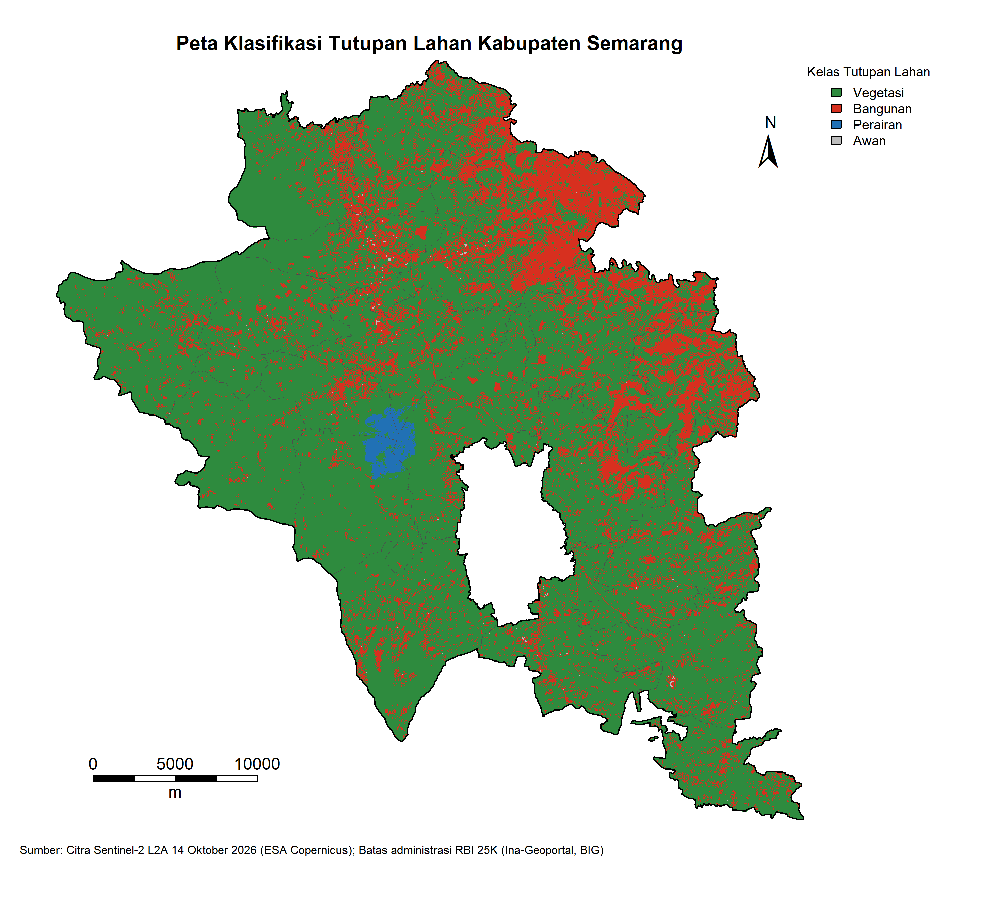

# Informasi Spasial Interaktif Kabupaten Semarang

Repository ini berisi tugas besar mata kuliah **Pemrograman Spasial A**, yaitu analisis
indeks spektral dan klasifikasi tutupan lahan Kabupaten Semarang menggunakan citra
Sentinel-2 dan R. Hasil analisisnya juga saya sajikan dalam bentuk dashboard peta interaktif.

Dikerjakan oleh **Katerine Thalia Syahiranadya (5016241126)**, dalam satu kelompok bersama
**Icha Ramanda Putri (5016241119)**.

## Tentang Project

Kabupaten Semarang dipilih sebagai area studi karena dalam satu wilayah terdapat variasi
tutupan lahan yang cukup lengkap: hutan dan perkebunan di lereng Gunung Ungaran dan Merbabu,
kawasan perkotaan di Ungaran, Ambarawa, dan Bawen, serta Danau Rawa Pening sebagai badan air.

Tahapan yang dikerjakan:
1. Menentukan area studi (19 kecamatan, luas 1.018,55 km²)
2. Mengunduh dan memotong citra Sentinel-2 sesuai batas kabupaten
3. Menghitung indeks NDVI, NDBI, NDWI, dan NDCI
4. Mengklasifikasikan tutupan lahan menjadi vegetasi, bangunan, perairan, dan awan
5. Menghitung zonal statistics (mean, min, max, median, standar deviasi) per kecamatan
6. Membuat peta dan dashboard interaktif

## Data

| Data | Keterangan | Sumber |
|------|-----------|--------|
| Citra Sentinel-2 Level-2A | 14 Oktober 2026, tile T49MDN dan T49MDM | ESA, Copernicus Data Space Ecosystem |
| Batas administrasi | RBI 1:25.000 Kabupaten Semarang tahun 2022 | Badan Informasi Geospasial, Ina-Geoportal |

Sistem koordinat yang digunakan adalah WGS 84 / UTM zona 49S (EPSG:32749). Data mentah
tidak saya unggah karena ukurannya sekitar 2 GB.

## Metode Klasifikasi

Indeks spektral dihitung dengan rumus:
- NDVI = (B8 − B4) / (B8 + B4)
- NDBI = (B11 − B8) / (B11 + B8)
- NDWI = (B3 − B8) / (B3 + B8)
- NDCI = (B5 − B4) / (B5 + B4)

Threshold ditentukan dengan membandingkan nilai rata-rata indeks pada setiap kelas
Scene Classification Layer (SCL) Sentinel-2, lalu dicek secara visual pada citra.

| Kelas | Kriteria |
|-------|----------|
| Awan | NDCI < 0,1 dan reflektan B3 > 0,3 |
| Perairan | NDWI > 0 |
| Bangunan | NDBI > 0 dan NDVI < 0,3 |
| Vegetasi | Piksel yang tidak masuk kelas lain |

## Hasil

| Kelas | Luas (km²) | Persentase |
|-------|-----------:|-----------:|
| Vegetasi | 804,77 | 78,86% |
| Bangunan | 206,28 | 20,21% |
| Perairan | 8,78 | 0,86% |
| Awan | 0,72 | 0,07% |



Dari hasil zonal statistics, kecamatan dengan NDVI rata-rata tertinggi adalah Jambu (0,640),
sedangkan yang terendah adalah Pringapus (0,320). Pringapus juga memiliki NDBI rata-rata
tertinggi (0,087). Nilai NDWI maksimum tertinggi terdapat di Tuntang (0,576) dan Banyubiru (0,536),
yang berbatasan langsung dengan Rawa Pening.

Tabel lengkapnya ada di `output/zonal_stats_semarang.csv`.

## Dashboard Interaktif

Dashboard dibuat menggunakan Shiny Dashboard dan Leaflet, dengan empat menu:
- **Klasifikasi Tutupan Lahan**: peta 4 kelas beserta batas kabupaten, batas kecamatan, dan nama kecamatan
- **Zonal Indeks per Kecamatan**: peta nilai rata-rata NDVI, NDBI, NDWI, dan NDCI per kecamatan
- **Statistik per Kecamatan**: tabel zonal statistics, histogram, dan grafik rata-rata indeks
- **Luas Kelas per Kecamatan**: tabel dan grafik komposisi tutupan lahan di tiap kecamatan

Setiap layer pada peta bisa dinyalakan atau dimatikan.

## Isi Repository

- `Klasifikasi Tutupan Lahan.R`: script analisis utama
- `Peta Interaktif Leaflet.R`: script dashboard interaktif
- `output/`: hasil analisis berupa peta (.png), tabel (.csv), raster klasifikasi (.tif), dan batas wilayah (.shp, .gpkg)

## Cara Menjalankan

1. Download repository ini (Code → Download ZIP), ekstrak, lalu buka `Peta Tutupan Lahan.Rproj` di RStudio.
2. Install package yang dibutuhkan:
```r
   install.packages(c("terra", "sf", "dplyr", "ggplot2", "ggspatial",
                      "shiny", "shinydashboard", "leaflet", "leaflet.extras"))
```
3. Untuk membuka dashboard, buka `Peta Interaktif Leaflet.R` lalu klik **Run App**.
   Data yang dibutuhkan sudah tersedia di folder `output/`.
4. Untuk menjalankan analisis dari awal, unduh data mentah dari sumber di atas,
   simpan di folder `data/`, lalu jalankan `Klasifikasi Tutupan Lahan.R` secara bertahap.

## Catatan

- Citra yang dipilih hampir bebas awan. Berdasarkan SCL, tidak ada piksel awan yang terdeteksi,
  sehingga kelas awan hanya 0,07% dan kemungkinan berasal dari atap atau permukaan yang sangat terang.
- Citra direkam pada akhir musim kemarau, sehingga NDBI juga menangkap sebagian lahan terbuka dan
  ladang kering. Karena itu ditambahkan syarat NDVI < 0,3 untuk kelas bangunan.
- Selama pengerjaan, sistem koordinat citra sempat tidak terbaca karena package terra bentrok dengan
  instalasi PostgreSQL/PostGIS di laptop. Masalah ini diatasi dengan menetapkan sistem koordinat
  secara manual sesuai metadata citra (EPSG:32749), serta melakukan reproyeksi menggunakan package sf.

## Tools

R, RStudio, terra, sf, ggplot2, Shiny, Leaflet, dan QGIS (untuk layout peta)
